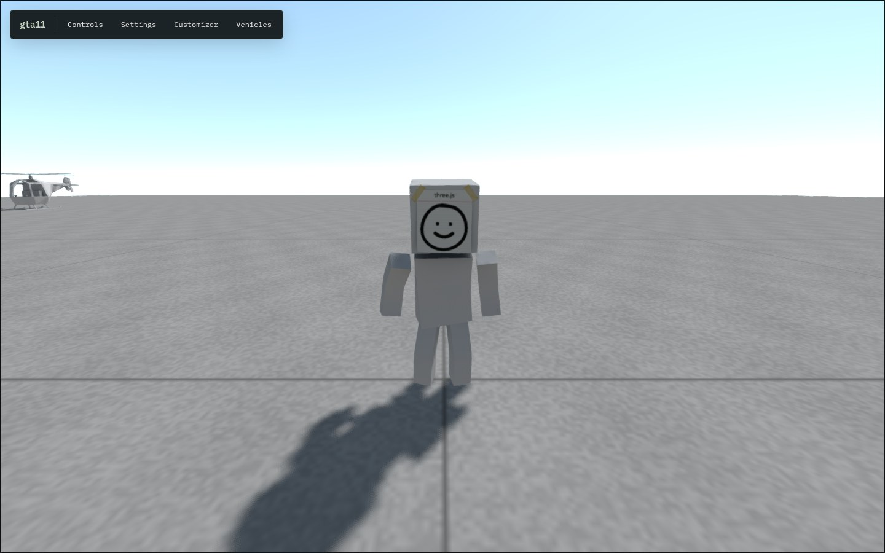
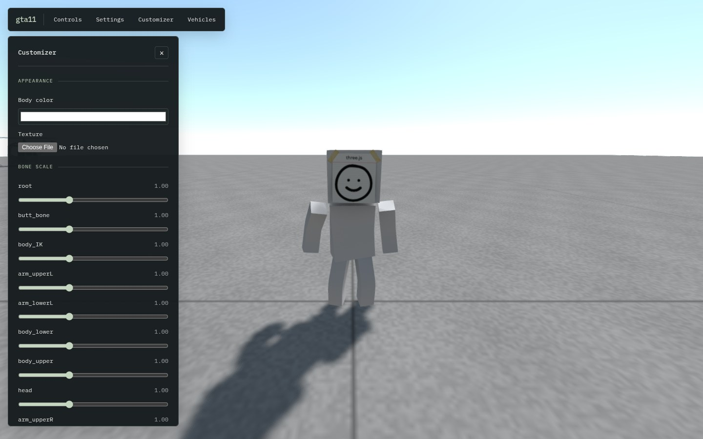
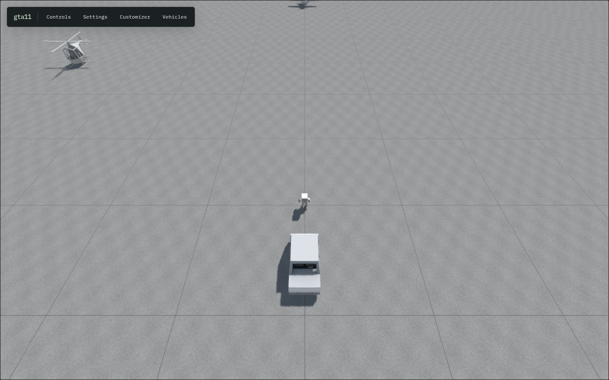

# gta1111

A browser-based 3D physics playground, called **gta11** in the game. Walk around as a character, enter vehicles, and experiment with character appearance and vehicle physics on a small test map.

This repository builds on the Sketchbook simulation with a React + React Three Fiber interface, Three.js rendering, and Cannon.js physics. The current starting scenario, **Small Plane**, is a flat 100 × 100 metre concrete platform with a player, car, helicopter, and airplane.

## Screenshots

Captured from this repository running locally in Chromium at 1440 × 900. These are actual game captures.



_The starting playground after pressing Play._



_The in-game customizer exposes body color, texture upload, bone scales, and saved presets._



_A bundled car GLB loaded through the Vehicles panel._

## What you can do

- Walk, sprint, jump, switch camera modes, and enter nearby vehicles.
- Drive a car or try the helicopter and airplane, with controls shown for the current vehicle.
- Customize the active character's body color, upload a texture, and adjust bone scales. Save color and scale presets in browser local storage.
- Spawn local `.glb` vehicles using Car, Truck, or Light physics presets. Saved vehicle configs retain the preset, not the model file; choose the GLB again when loading one.
- Adjust lighting, time scale, shadows, FXAA, field of view, and render scale from Settings.
- Switch between WASD and arrow keys, enable touch controls with Mobile mode, and inspect FPS, performance, or physics debug overlays.

Custom vehicle models need the simulation's wheel, seat, and collision metadata to behave correctly. The Vehicles panel warns when these markers are missing.

## Run locally

Use **Node.js 24 LTS** and **pnpm**. The development workflow has been verified with Node 24.19.0 and pnpm 11.25.0. A browser with WebGL support is required; no backend service or API key is needed.

```bash
git clone https://github.com/12ants/gta1111.git
cd gta1111
pnpm install --frozen-lockfile
pnpm dev
```

Open the address printed by Vite and press **Play** once loading finishes. For a remotely hosted development server, use `pnpm dev --host 0.0.0.0`.

## Controls

Click the playfield to capture the mouse when Pointer lock is enabled; press **Esc** to release it. With Pointer lock disabled in Settings, drag on the playfield to look around. Close any open HUD panel to resume game input.

| Input         | On foot                                      |
| ------------- | -------------------------------------------- |
| W / A / S / D | Move                                         |
| Shift         | Sprint                                       |
| Space         | Jump                                         |
| F / G         | Enter a nearby vehicle as driver / passenger |
| V             | Cycle camera mode                            |
| Shift + R     | Respawn                                      |
| Shift + C     | Toggle free camera                           |
| P             | Toggle performance overlay                   |

Open **Controls** for the active character or vehicle's bindings. Settings can remap movement to arrow keys or enable on-screen touch controls.

## Development

| Command             | Purpose                                                   |
| ------------------- | --------------------------------------------------------- |
| `pnpm dev`          | Start the Vite development server                         |
| `pnpm test`         | Run Vitest tests with Testing Library and jsdom           |
| `pnpm typecheck`    | Check TypeScript project references without emitting code |
| `pnpm build`        | Type check and build production files into `dist/`        |
| `pnpm preview`      | Serve the production build locally after building         |
| `pnpm format`       | Check formatting with Prettier                            |
| `pnpm build:map`    | Regenerate the starting map GLB                           |
| `pnpm build:models` | Regenerate typed GLTFJSX model components                 |

Before committing, run:

```bash
pnpm test && pnpm typecheck && pnpm build
```

Asset generation is a separate authoring step, not required to start or build the game. Before regenerating model components, read the manual touch-up instructions in [tools/build-model-components.mjs](tools/build-model-components.mjs).

## Project layout

| Path                | Contents                                                       |
| ------------------- | -------------------------------------------------------------- |
| `src/App.tsx`       | React canvas, rendering effects, and HUD entry point           |
| `src/game/runtime/` | Bridge between React Three Fiber and the simulation            |
| `src/game/ui/`      | HUD, settings, customizer, vehicle loader, and shared UI store |
| `src/game/models/`  | Generated typed GLTFJSX components and model path exports      |
| `src/ts/`           | World simulation, characters, vehicles, input, and physics     |
| `src/lib/cannon/`   | Bundled legacy Cannon.js physics implementation                |
| `public/assets/`    | Runtime GLB scenes and models                                  |
| `tools/`            | Map and model generation scripts                               |

React Three Fiber owns the canvas and frame loop; `World` owns the simulation. The UI communicates with the simulation through a shared external store and explicit world methods. See [the architecture guide](docs/gta11-architecture.md) and [AGENTS.md](AGENTS.md) for development constraints.

## Assets

GLBs in `public/assets/` are served at stable `/assets/…` URLs and remain necessary for geometry, textures, animations, and simulation metadata. Model components export `MODEL_PATH` constants; reuse those paths when adding loaders.

The original world and Blender sources are no longer in the checkout; Git history retains them. Some model components record third-party author and license information—check those notices before reusing or redistributing assets.
